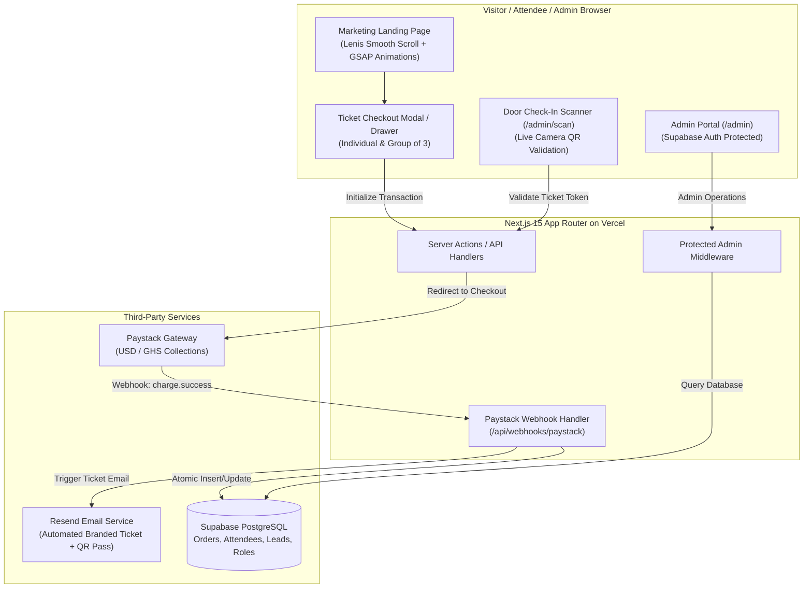

# ACE GLOBAL SUMMIT — Architecture Blueprint & Scaffolding Runbook

**Date:** October 12, 2026  
**Event:** ACE GLOBAL SUMMIT (Inaugural Edition)  
**Date of Event:** December 23, 2026 (One-Day Summit)  
**Host Venue:** Accra Marriott Hotel, Accra, Ghana  
**Organizer:** Reinvent Africa Network (RAN)  
**Deployment Target:** Vercel  

---

## 1. System Overview & Technology Stack



### Approved Core Technologies
- **Runtime & Package Manager:** Node.js v24 + `pnpm` (Pinned via `"packageManager": "pnpm@..."`)
- **Web Framework:** **Next.js 15 (App Router)** with TypeScript
- **Styling & Design Tokens:**
  - Tailwind CSS
  - Custom Brand Tokens:
    - Primary Background: Deep Maroon (`#62060E`)
    - Headline & High-Impact Accents: Bright Orange (`#FF6417`)
    - Buttons & Interactive Elements: Burnt Orange (`#E65100`)
    - Surface & Typography: White (`#FFFFFF`) & Slate Neutrals
- **Smooth Motion & Kinetics:**
  - **Lenis Smooth Scroll** (`lenis`) for luxury editorial scrolling feel
  - **GSAP** (`gsap` + `ScrollTrigger`) for scroll-driven reveals and micro-interactions
- **Database & Data Layer:** **Supabase PostgreSQL**
  - Supabase JavaScript Client (`@supabase/supabase-js`, `@supabase/ssr`)
- **Authentication:** **Supabase Auth** with role-based access for organizers & staff
- **Payments:** **Paystack**
  - Standard & Popup Checkout flows
  - Secure cryptographic HMAC SHA-512 Webhook signature verification
  - Currency handling: USD default (with optional GHS conversion)
  - Ticket types: General ($150), VIP ($170), General Group of 3 ($400), VIP Group of 3 ($470)
- **Email & Ticket Delivery:** **Resend** + `@react-email/components`
  - Automated HTML email dispatch with personalized attendee ticket details and scannable QR verification code
- **Hosting & CI/CD:** **Vercel**

---

## 2. Package Management & Caching Strategy

### How `pnpm` Handles GSAP & Lenis
1. **Local Disk & Global Store**: `pnpm` utilizes a centralized, content-addressable store on your hard drive (`%LOCALAPPDATA%\pnpm\store`). When `gsap` and `lenis` are installed in this project, `pnpm` hard-links them from your existing machine cache in milliseconds with zero redundant network downloads.
2. **Vercel Cloud Compatibility**: To ensure Vercel can build the website in production without errors, dependencies must be declared in the project's `package.json`.

---

## 3. Database Schema Blueprint (Supabase PostgreSQL)

```sql
-- 1. Profiles & Admin Roles
CREATE TABLE public.profiles (
  id UUID REFERENCES auth.users ON DELETE CASCADE PRIMARY KEY,
  email TEXT NOT NULL,
  full_name TEXT,
  role TEXT DEFAULT 'staff' CHECK (role IN ('admin', 'staff')),
  created_at TIMESTAMPTZ DEFAULT NOW()
);

-- 2. Orders Table (Paystack Transactions)
CREATE TABLE public.orders (
  id UUID PRIMARY KEY DEFAULT gen_random_uuid(),
  paystack_reference TEXT UNIQUE NOT NULL,
  customer_email TEXT NOT NULL,
  customer_name TEXT NOT NULL,
  customer_phone TEXT,
  ticket_type TEXT NOT NULL CHECK (ticket_type IN ('general', 'vip', 'general_group', 'vip_group')),
  quantity INT NOT NULL DEFAULT 1,
  unit_price NUMERIC(10,2) NOT NULL,
  total_amount NUMERIC(10,2) NOT NULL,
  currency TEXT DEFAULT 'USD',
  payment_status TEXT DEFAULT 'pending' CHECK (payment_status IN ('pending', 'paid', 'failed', 'refunded')),
  metadata JSONB DEFAULT '{}'::jsonb,
  paid_at TIMESTAMPTZ,
  created_at TIMESTAMPTZ DEFAULT NOW()
);

-- 3. Attendees & Tickets Table
CREATE TABLE public.tickets (
  id UUID PRIMARY KEY DEFAULT gen_random_uuid(),
  order_id UUID REFERENCES public.orders(id) ON DELETE CASCADE NOT NULL,
  ticket_code TEXT UNIQUE NOT NULL, -- e.g. ACE-VIP-982341
  ticket_tier TEXT NOT NULL CHECK (ticket_tier IN ('general', 'vip')),
  attendee_name TEXT NOT NULL,
  attendee_email TEXT NOT NULL,
  attendee_phone TEXT,
  is_checked_in BOOLEAN DEFAULT FALSE,
  checked_in_at TIMESTAMPTZ,
  checked_in_by UUID REFERENCES public.profiles(id),
  qr_token TEXT UNIQUE NOT NULL, -- Cryptographic hash or UUID for door validation
  created_at TIMESTAMPTZ DEFAULT NOW()
);

-- 4. Leads & Waitlist (Speaker reveals & Schedule notification)
CREATE TABLE public.leads (
  id UUID PRIMARY KEY DEFAULT gen_random_uuid(),
  email TEXT NOT NULL,
  interest_type TEXT NOT NULL CHECK (interest_type IN ('schedule', 'speakers', 'partnership', 'general')),
  created_at TIMESTAMPTZ DEFAULT NOW(),
  CONSTRAINT unique_email_interest UNIQUE(email, interest_type)
);
```

---

## 4. Application Directory Structure

```
c:\Users\kingd\AGS\
├── .firecrawl/              # Parsed briefs and reference files
├── src/
│   ├── app/
│   │   ├── (public)/        # Public-facing summit routes
│   │   │   ├── page.tsx     # Full Landing Page (Hero, Pillars, Schedule, Tickets, FAQ, etc.)
│   │   │   ├── layout.tsx   # Root layout with Lenis provider and header/footer
│   │   │   ├── tickets/
│   │   │   │   ├── success/ # Confirmation & ticket download page
│   │   │   │   └── verify/  # Ticket verification lookup
│   │   ├── admin/           # Organizer Portal
│   │   │   ├── login/       # Supabase Auth login
│   │   │   ├── dashboard/   # Metrics, sales overview, revenue charts
│   │   │   ├── attendees/   # Attendee roster, CSV export, search
│   │   │   ├── leads/       # Speaker & schedule notification subscribers
│   │   │   └── scan/        # Live QR ticket scanner for door staff
│   │   ├── api/
│   │   │   ├── checkout/    # Paystack transaction initialization
│   │   │   ├── webhooks/
│   │   │   │   └── paystack/# Secure Paystack webhook listener
│   │   │   └── leads/       # Waitlist / newsletter subscription endpoint
│   ├── components/
│   │   ├── landing/         # Hero, Pillars, Schedule, TicketsSection, Venue, etc.
│   │   ├── motion/          # LenisProvider, GSAP ScrollTrigger wrapper, Reveal animations
│   │   ├── checkout/        # Attendee details modal & Paystack popup trigger
│   │   ├── admin/           # Dashboard stats, attendee table, QR scanner component
│   │   └── ui/              # Button, Modal, Badge, Card, Input, Tabs (Tailwind)
│   ├── lib/
│   │   ├── supabase/        # Supabase client (client.ts, server.ts, admin.ts)
│   │   ├── paystack.ts      # Paystack SDK / REST helper with HMAC verification
│   │   ├── email.ts         # Resend client + Ticket email template
│   │   └── utils.ts         # Formatting, currency helpers, ticket code generator
│   └── styles/
│       └── globals.css      # Custom color tokens & Lenis CSS resets
├── public/                  # Brand assets, logos, Marriott imagery
├── package.json
├── pnpm-lock.yaml
├── tailwind.config.ts
├── tsconfig.json
└── next.config.ts
```

---

## 5. Execution Order
1. **Initialize Project Skeleton**: Scaffold Next.js 15 with TypeScript, Tailwind CSS, and `pnpm`.
2. **Install Core Dependencies**: Add `gsap`, `lenis`, `@supabase/supabase-js`, `@supabase/ssr`, `lucide-react`, `qrcode`.
3. **Configure Brand Design System**: Tailwind configuration with `#62060E`, `#FF6417`, `#E65100`, `#FFFFFF`.
4. **Build Kinetic Public Landing Page**: Implement all 12 copy sections, smooth scroll, ticket selection toggles, and notification forms.
5. **Implement Checkout & Paystack Integration**: Checkout forms (single and group of 3), Paystack initialize API, and secure webhook handler.
6. **Implement Admin Portal**: Supabase auth gate, dashboard metrics, attendee roster with CSV export, and QR ticket verification.
